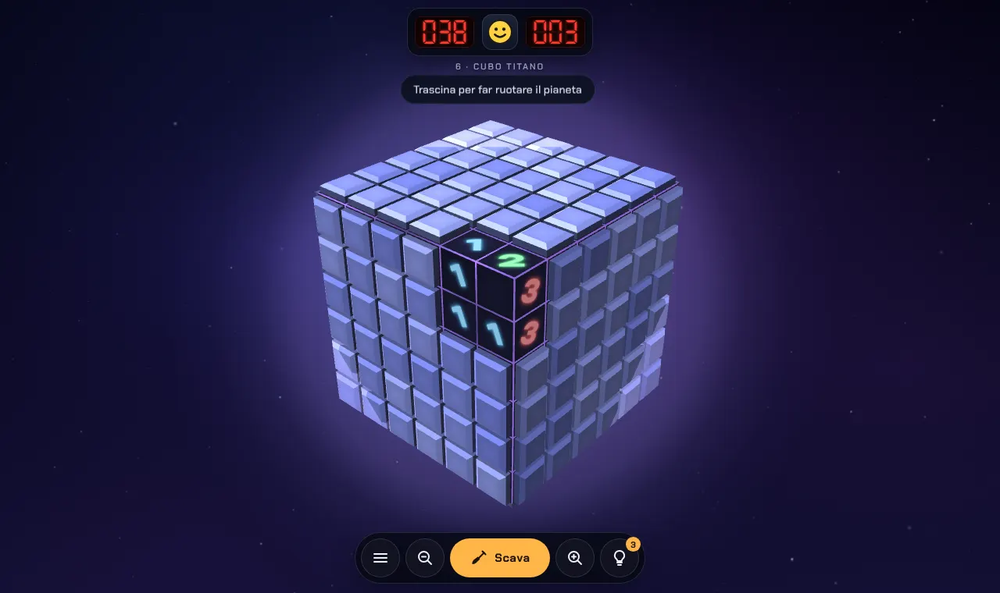
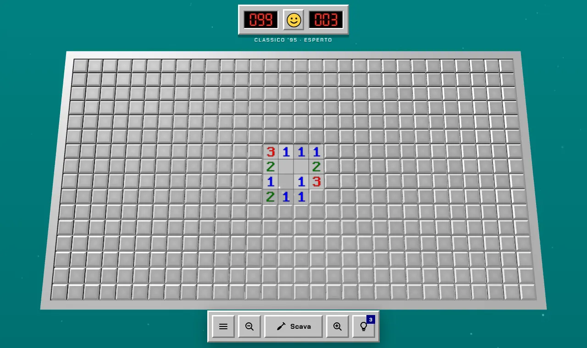
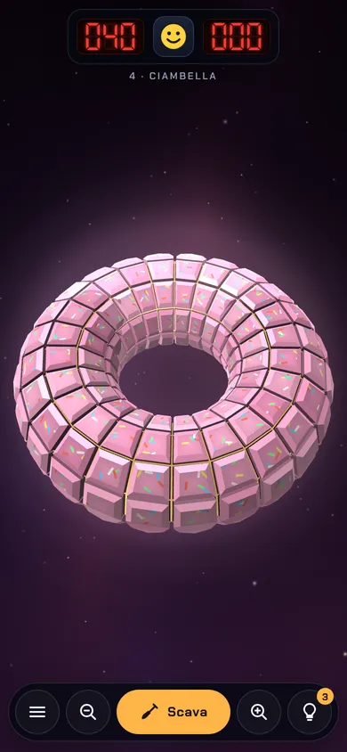

# Mondi Minati

Il campo minato in 3D, un pianeta alla volta. Three.js e JavaScript puro, nessun framework: la build è un sito statico pronto per Cloudflare Pages.


| Cubo Titano | Classico '95 |
| --- | --- |
|  |  |



## Cosa c'è dentro

- **Campagna di 10 mondi**, ognuno con una forma che cambia le regole:
  - sfere esagonali: 6 vicine, 5 sui 12 pentagoni;
  - cubi: le vicine continuano sulla faccia accanto, 7 negli angoli;
  - ciambella (toro): nessun bordo, sempre 8 vicine;
  - asteroide bitorzoluto e gigante gassoso con anelli.
- **Classico '95**: campo piatto grigio su sfondo verde acqua, contatori LED e faccina (9×9, 16×16, 30×16).
- **Sfida del giorno**: stesso pianeta per tutti, generato dalla data.
- **Partita libera**: forma, misura e difficoltà a scelta.
- **Niente tentativi alla cieca**: la prima mossa è sicura e ogni campo viene verificato da un risolutore logico prima di giocarlo.
- Aiuti (3 per mondo), annulla mossa dopo un'esplosione, stelle e record salvati nel browser.
- Effetti e musica sintetizzati con WebAudio, senza file audio.
- Italiano e inglese.
- Installabile come app dal browser (PWA) e giocabile offline dopo la prima apertura.

## Comandi

| Azione | Telefono | Computer |
| --- | --- | --- |
| Scava | tocco | clic |
| Bandiera | pressione lunga, o pulsante centrale | clic destro, tasto F |
| Apri le vicine di un numero completo | tocco sul numero | clic sul numero, clic centrale |
| Ruota / sposta | trascina | trascina, frecce |
| Zoom | pizzica | rotella, + e − |
| Aiuto / ricomincia / pausa | pulsanti in basso, faccina | H, R, Esc |

## Sviluppo

Serve Node 20 o superiore.

```bash
npm install
npm run dev      # http://localhost:5173, ricostruisce a ogni modifica
npm test         # geometrie, regole e risolutore
npm run build    # sito statico in dist/
```

Aggiungi `?debug` all'indirizzo per avere `window.__mm` in console (stato della partita e funzioni di gioco).

## Pubblicare su Cloudflare Pages

Con il repository collegato, ogni push su `main` ripubblica il sito.

1. Dashboard Cloudflare → **Workers & Pages** → **Create** → **Pages** → **Connect to Git**.
2. Scegli `Amaraciuri/mondi-minati`, branch `main`.
3. Impostazioni di build:
   - Framework preset: **None**
   - Build command: `npm run build`
   - Build output directory: `dist`
4. **Save and Deploy**.

In alternativa, da terminale: `npm run build && npx wrangler pages deploy dist --project-name mondi-minati`.

`public/_headers` imposta la cache lunga sui file con hash (`/assets`, `/fonts`) e alcuni header di sicurezza.

## App per telefono (Capacitor)

`dist/` contiene già three.js e i font, quindi funziona anche offline dentro un'app.

```bash
npm i @capacitor/core @capacitor/android @capacitor/ios
npm i -D @capacitor/cli
npx cap init "Mondi Minati" com.tuodominio.mondiminati --web-dir dist
npm run build && npx cap add android && npx cap add ios && npx cap sync
```

## Struttura

| File | Cosa fa |
| --- | --- |
| `src/main.js` | flusso di gioco, schermate, input, salvataggi |
| `src/shapes.js` | geometrie (sfera di Goldberg, cubo, toro, asteroide, piano) e vicine calcolate dagli angoli condivisi |
| `src/minesweeper.js` | regole, risolutore logico, generatore di campi senza tentativi |
| `src/render/planet.js` | tutte le tessere in una sola mesh animata nello shader, bandiere, mine, nucleo luminoso |
| `src/render/atlas.js` | numeri e icone disegnati in una texture |
| `src/render/fx.js` | stelle, nebulosa, particelle |
| `src/render/map.js` | mappa della campagna |
| `src/rig.js` | camera, rotazione a trackball con inerzia, zoom, spostamento del piano |
| `src/input.js` | tocco, pressione lunga, clic destro, pinch, rotella |
| `src/audio.js` | effetti e musica sintetizzati |
| `src/levels.js` | mondi, temi, modalità |
| `src/i18n.js` | testi in italiano e inglese |
| `src/ui.js` | HUD, contatori a 7 segmenti, faccina, finestre |
| `src/sw.js` | service worker per il gioco offline |
| `build.mjs` | build `site` (Cloudflare), `artifact` (pagina unica con three.js da CDN), `test` |
| `public/` | icone, manifest PWA, `_headers` |
| `test/` | test di logica (`core.test.mjs`) e script Playwright per il browser |

## Test nel browser

```bash
npm run build:test
python3 -m http.server 8765        # dalla cartella del progetto
python3 test/smoke.py desktop level0,click,autoplay
```

Gli screenshot finiscono in `shots/`.
