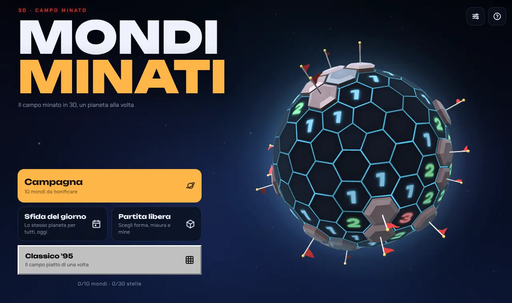
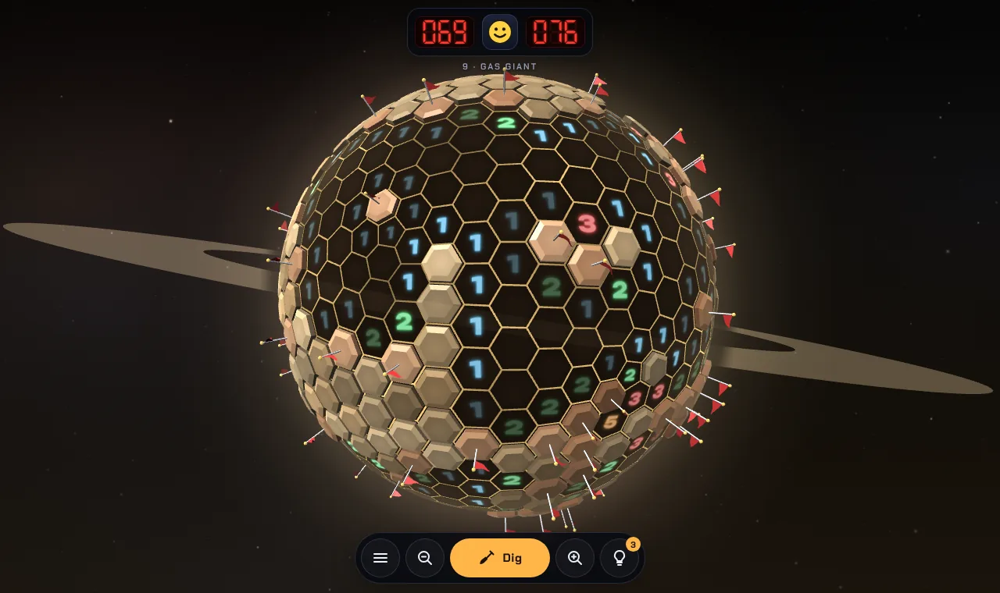
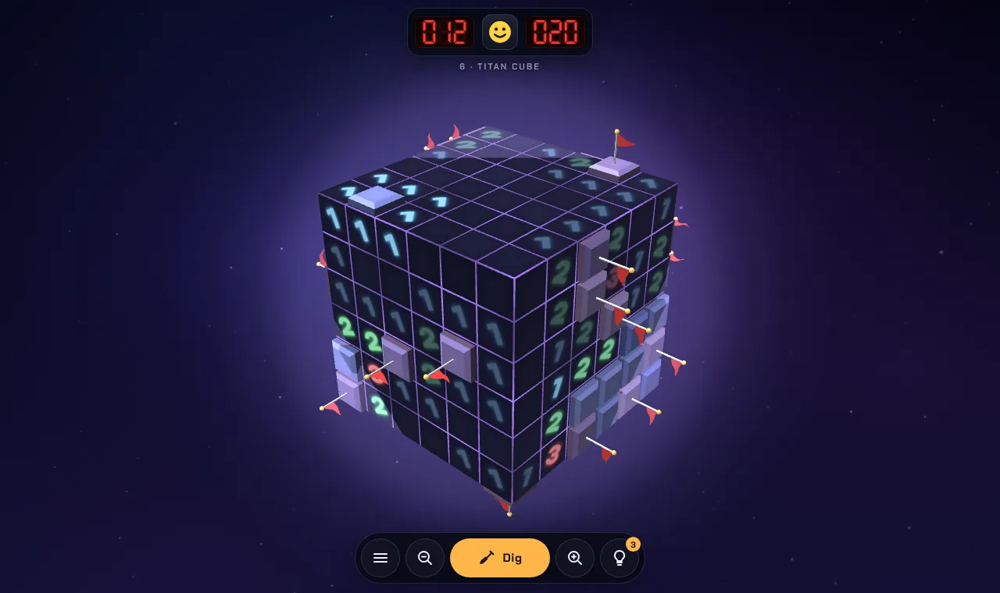
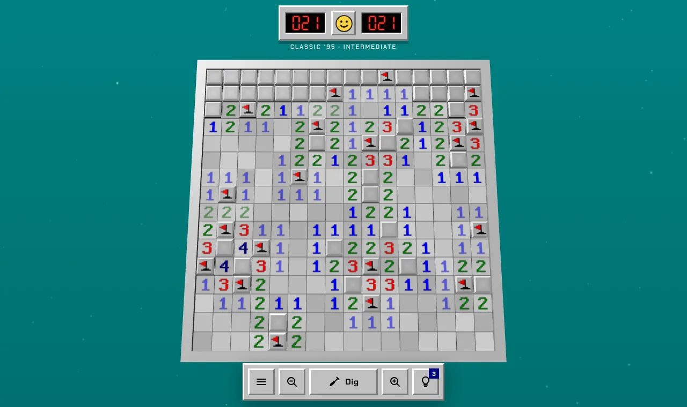
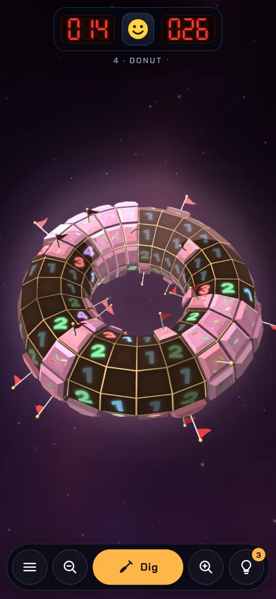

# Mined Worlds (Mondi Minati)

Minesweeper in 3D, one planet at a time. Three.js and plain JavaScript, no framework: the build is a static site.

**[▶ Play it in your browser](https://mondi-minati.davide-venezia.workers.dev/)**: phone or computer, nothing to install.

The game is in English and Italian. It follows the device language (Italian devices get Italian, everything else English), and the player can switch from the title screen or in Settings.



| Gas Giant | Titan Cube |
| --- | --- |
|  |  |
| **Classic '95** | **Donut, on a phone** |
|  |  |

## What's inside

- **A 10-world campaign**, where each shape changes the rules:
  - hex spheres: 6 neighbours, 5 on the 12 pentagons;
  - cubes: neighbours continue onto the next face, 7 on the corners;
  - a donut (torus): no edges at all, always 8 neighbours;
  - a lumpy asteroid and a ringed gas giant.
- **Classic '95**: the flat grey field on a teal background, with LED counters and the smiley (9×9, 16×16, 30×16).
- **Daily challenge**: the same planet for everyone, generated from the date.
- **Free play**: pick shape, size and difficulty.
- **No blind guessing**: the first move is always safe and every field is checked by a logic solver before you play it (on by default, can be turned off in Settings).
- Hints (3 per world), undo after an explosion, stars and records saved in the browser.
- Sound effects and music synthesized with WebAudio, no audio files.
- Installable from the browser (PWA) and playable offline after the first visit.

## Controls

| Action | Phone | Computer |
| --- | --- | --- |
| Dig | tap | click |
| Flag | press and hold, or the centre button | right-click, F key |
| Open the neighbours of a satisfied number | tap the number | click the number, middle-click |
| Rotate / move | drag | drag, arrow keys |
| Zoom | pinch | wheel, + and − |
| Hint / restart / pause | bottom buttons, smiley | H, R, Esc |

## Development

Needs Node 20 or later.

```bash
npm install
npm run dev      # http://localhost:5173, rebuilds on every change
npm test         # geometry, rules and solver
npm run build    # static site in dist/
```

Add `?debug` to the URL to get `window.__mm` in the console (game state and game functions).

## Deploy

`npm run build` writes a static site to `dist/` that any static host can serve. The live version runs on Cloudflare, connected to this repository: every push to `main` rebuilds and redeploys it.

To host your own copy on Cloudflare Pages:

1. Cloudflare dashboard → **Workers & Pages** → **Create application** → **Pages** tab → **Import an existing Git repository**.
2. Pick `Amaraciuri/mondi-minati`, branch `main`, then **Begin setup**.
3. Build settings:
   - Framework preset: **None**
   - Build command: `npm run build`
   - Build output directory: `dist`
4. **Save and Deploy**.

From a terminal instead: `npm run build && npx wrangler pages deploy dist --project-name mondi-minati`.

`public/_headers` sets long-term caching on the hashed files (`/assets`, `/fonts`) and a few security headers.

Link previews (WhatsApp, Telegram, LinkedIn, X) use `public/og.jpg` and need absolute URLs: if you deploy somewhere else, build with `SITE_URL=https://your.domain npm run build`.

## Phone app (Capacitor)

`dist/` already contains three.js and the fonts, so it also works offline inside an app.

```bash
npm i @capacitor/core @capacitor/android @capacitor/ios
npm i -D @capacitor/cli
npx cap init "Mined Worlds" com.yourdomain.minedworlds --web-dir dist
npm run build && npx cap add android && npx cap add ios && npx cap sync
```

## Project layout

| File | What it does |
| --- | --- |
| `src/main.js` | game flow, screens, input wiring, saves |
| `src/shapes.js` | board geometry (Goldberg sphere, cube, torus, asteroid, flat) with neighbours computed from shared corners |
| `src/minesweeper.js` | rules, logic solver, no-guess field generator |
| `src/render/planet.js` | every tile in one mesh animated in the shader, flags, mines, glowing core |
| `src/render/atlas.js` | numbers and icons drawn into a texture |
| `src/render/fx.js` | stars, nebula, particles |
| `src/render/map.js` | campaign map |
| `src/rig.js` | camera, trackball rotation with inertia, zoom, panning the flat board |
| `src/input.js` | tap, press and hold, right-click, pinch, wheel |
| `src/audio.js` | synthesized sound effects and music |
| `src/levels.js` | worlds, themes, game modes |
| `src/i18n.js` | English and Italian text |
| `src/ui.js` | HUD, 7-segment counters, smiley, dialogs |
| `src/sw.js` | service worker for offline play |
| `build.mjs` | builds `site` (Cloudflare), `artifact` (one page with three.js from a CDN) and `test` |
| `public/` | icons, PWA manifest, `_headers` |
| `test/` | logic tests (`core.test.mjs`) and Playwright scripts for the browser |

## Browser tests

```bash
npm run build:test
python3 -m http.server 8765        # from the project folder
python3 test/smoke.py desktop level0,click,autoplay
```

Screenshots are written to `shots/`. `python3 test/readme_shots.py` regenerates the pictures in this README and the link preview.

## Credits

- [three.js](https://threejs.org) (MIT license).
- Fonts: [Unbounded](https://fontsource.org/fonts/unbounded) and [Chakra Petch](https://fontsource.org/fonts/chakra-petch), served from [Fontsource](https://fontsource.org) packages (SIL Open Font License 1.1).
- Sound effects and music are synthesized in the browser: no audio files.
